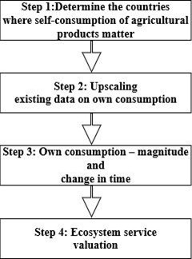

\noindent\textbf{Keywords:} Crop Production, Own Consumption, Gross-ecosystem Product (GEP), Ecosystem Services, Agricultural Economics

<!-- Section: Introduction -->

# Introduction

Nature underpins agricultural production, yet most macroeconomic accounting frameworks capture only marketed output. This creates a systematic blind spot for own-consumption and subsistence-oriented production, especially in low- and lower-middle-income countries (LMICs) where households depend on farm output for direct consumption. Standard national accounts, which follow GDP logic, treat non-marketed agricultural provisioning as invisible to economic measurement. Yet for food security and rural livelihoods in developing regions, this own-consumption agriculture remains economically and socially meaningful.

This paper investigates the extent to which subsistence agriculture in LMICs depends on ecosystem services—specifically, nature's provision to crop production. We ask three interconnected questions. What is the magnitude of natural capital flows to subsistence-crop production at the global and country level? How has this reliance on ecosystem services changed over time? Which countries face the highest vulnerability to degradation of ecosystem-supported agriculture?

We address these questions using Gross Ecosystem Product (GEP) accounting in a manner consistent with the UN System of Environmental–Economic Accounting (SEEA-EA). Using FAO data on household own-consumption of agricultural products as a proxy for subsistence agriculture, we construct a reproducible workflow that: (i) estimates own-consumption value where survey data exists, (ii) interpolates missing values within observed countries, and (iii) extrapolates to a wider LMIC panel using correlation-based FAO regressions. We then translate own-consumption values into subsistence-crop GEP using country-specific natural capital rental rates from the CWON crop coefficient database.

The result is a transparent panel dataset spanning 2004–2021, covering 99 countries with country-year estimates of subsistence-crop GEP. For the year 2019, we estimate global subsistence-crop GEP at approximately USD 1.83 billion across our panel.

We first outline the conceptual background for own consumption, subsistence farming, and ecosystem accounting (Section 2). We then describe data sources, sample selection, and the core workflow for estimating own-consumption GEP (Section 3). Results present coverage, country-level GEP rankings, temporal trends, and vulnerability indices (Section 4). We conclude by discussing methodological contributions, implications of our findings, and the counterfactual importance of ecosystem service degradation (Section 5).

<!-- Section: Background -->
# Background and Conceptual Framework

## Ecosystem Services and Subsistence Agriculture

Ecosystem services are benefits that people obtain from nature [@MEA2005]. These benefits may be material or non-material in character. Global estimates of ecosystem service flows are available for some sectors [@ChaplinKramer2019], particularly commercial food production, which can be modeled using biophysical approaches or economic valuation methods. Food provision is typically assessed on the basis of yield estimates [@Ouyang2016] or commercial market values. Most ecosystem-service assessments prioritize commercial food production, employing biophysical accounting approaches [@PerezSoba2019; @Schroeter2021; @Vallecillo2018] or economic valuation methods, while subsistence and own-consumption agriculture are largely overlooked or omitted entirely. To our knowledge, this represents the first attempt to assess subsistence or own-consumption agriculture at the global scale using SEEA-EA ecosystem accounting logic, building on preliminary work such as the ecosystem accounting for walnuts in Kyrgyzstan [@Sylla2021].

Nature's contribution to agriculture remains economically significant even where production falls outside formal markets. The growth rate of commercial agriculture globally is lower than that of industry and services, leading to a diminishing share of agriculture in GDP [@PintoCorreia2021]. However, in many developing countries, subsistence-oriented agriculture remains central to household food security and rural livelihoods. Driving forces for this persistence include high food prices, limited market access, and risk aversion, which together incentivize households to produce their own food to buffer against market volatility and ensure dietary diversity [@Beumer2022]. Risk aversion and cultural preferences for specific home-produced varieties further reinforce subsistence practices, while smallholders increasingly rely on home-grown staples where market access remains limited [@Beumer2022].

## Own Consumption and Subsistence Farming

Subsistence farming differs from farming for own consumption, though the distinction is blurred by data availability. The Eurostat glossary [@EurostatSubsistence2024] defines subsistence farming as "agricultural activity to produce food which is predominantly consumed by the farming household. The food produced is the main or significant source of food for the farming household and little or none is surplus for sale or trade. It is generally associated with small farm holding size and family agricultural work as part-time or supporting activity." The Cambridge dictionary [@CambridgeSubsistence2024] offers a stricter definition: "farming that provides enough food for the farmer and their family to live on, but not enough to sell."

The SEEA-EA framework [@UNSEEAEA2021] places ecosystem contribution to subsistence production of agriculture within the scope of ecosystem accounts and defines subsistence food provision as "outputs from growing and harvesting activities are not sold on markets but directly consumed by households." This definition extends to non-timber forest products foraged for own purposes. The SEEA-EA also provides guidance on exchange valuation methods for monetizing ecosystem contributions to subsistence farming outputs; estimated market prices of similar goods sold on markets represent the best valuation approach.

The FAO does not directly collect data on subsistence agriculture; instead, it gathers data on own consumption of agricultural products across farmers of different holding sizes. Own consumption is understood as the percentage of total farm output dedicated to household consumption, with the remainder available for sale and typically marketed. This approach is less strict than the Eurostat subsistence farming definition but allows for the proportioning of commercial agriculture shares dedicated to own consumption. Own consumption is particularly important in developing countries where food insufficiency is significant and farm holdings tend to be small and family-based. Small and family farms predominate globally in terms of number of holdings [@Lowder2016; @Lowder2021], and own production is characteristic of these smaller operations.

## Natural Capital Accounting and GEP

Under the System of National Accounts (SNA), only market transactions contribute to GDP, leaving subsistence outputs uncounted. The SEEA-EA aims to address this gap by leveraging existing data sources—such as FAO own-consumption figures—to produce comprehensive ecosystem-service satellite accounts consistent with national accounting frameworks. This approach treats ecosystem service flows as natural capital contributions that can be valued and tracked over time.

Gross Ecosystem Product (GEP) is an accounting framework designed to measure nature's contribution to economic production. In the agricultural context, GEP captures the value of ecosystem services (nutrient cycling, water provision, pollination) that underpin crop production. A common valuation approach uses rental rates or land-rent coefficients—the proportion of agricultural output attributable to the use of land and its ecosystem services, as opposed to labour, capital, or technology inputs. These rental rates vary substantially across regions and time periods, reflecting differences in agricultural intensification and technology adoption.

<!-- Section: Data and Methods -->
# Data and Methods

## Sample Definition and Data Sources

### Geographic Scope: LMIC Countries

To determine countries in which subsistence agriculture plays a significant role, we restrict the analysis to low- and lower-middle-income countries (LMIC) as classified by the World Bank. While farmers in high and upper-middle-income countries may produce agricultural products for their own consumption, we focus on LMICs where food insecurity is prevalent and subsistence agriculture is most consequential for household food security and rural livelihoods.

Country selection is informed by multiple global food security indicators, including the Integrated Food Security Phase Classification (IPC) and the World Food Programme's Prevalence of Insufficient Food Consumption index. Countries classified by both systems consistently fall into the LMIC category, providing a principled basis for sample restriction.

### Primary Data Source: FAO RuLIS

Data on own consumption comes from the FAO RuLIS - Rural Livelihoods Information System [@FAORuLIS2024]. After harmonising country identifiers and restricting to LMICs, the raw FAO RuLIS dataset comprises 73 country-year observations spanning 36 countries over 2004–2021. Following exclusion of high-income countries (Bulgaria, Panama) and upper-middle-income countries with only a single outdated observation (Albania, Mexico, South Africa), the working sample comprises 33 countries with 63 country-year observations.

Geographically, the coverage is heavily skewed towards Sub-Saharan Africa, accounting for 56% of observations. A critical limitation is temporal sparsity: 52% of retained countries have only a single survey year. This motivates a two-stage gap-filling procedure: within-country interpolation for observed countries, followed by cross-country extrapolation.

### Supplementary Data Sources

Computations of own-consumption value draw on:

* **Production and land area**: FAOSTAT data on agricultural production value, cropland area, and agricultural land area
* **Smallholder shares**: Lowder et al. regional estimates of the share of farmland managed by smallholders
* **Natural capital rental rates**: CWON (Cropland and Woodland Own capital Net) crop coefficient database, providing country-year specific rental-rate multipliers

## Converting Own Consumption into Subsistence Agriculture GEP

Our operational estimate for own-consumption crop value at the country-year level is:

$$
\text{OwnCons}_{c,t} = \text{ProdPerArea}_{c,t} \times \text{Cropland}_{c,t} \times \text{SmallholderShare}_{r} \times \text{OwnConsShare}_{c,t}
$$

where $c$ denotes country, $t$ denotes year, and $r$ denotes region. This formula estimates the value of own-consumption crop production by combining: (i) agricultural productivity per hectare, (ii) total cropland area under cultivation, (iii) the regional share of cropland managed by smallholders, and (iv) the share of production destined for own consumption.

We show graphically below our procedure of transforming FAO own consumption values into natural capital accounts. 

### Interpolation Approach

For countries with at least one FAO RuLIS observation, we interpolate own-consumption shares across the full 2004–2021 study window. Where two or more observations exist, linear interpolation fills interior years and flat extrapolation extends to boundary years using the nearest observed value. For single-observation countries—which represent the majority—we apply a ratio-based fallback that scales the observed own-consumption share proportionally to changes in commercial agricultural production value. The underlying assumptions of this interpolation method is that rates of own consumption are correlated to changes in commerical agricutlural markets (e.g., they are porportionally responsive) and that own consumption follows a linear trendline over time.

### Extrapolation Approach

Since FAO RuLIS only covers 33 countries, the source data vastly under-represents own consumption in LMIC especially in large developing, agricultural socieities such as China and India. To expand global coverage, we rely on a transparent correlation-based FAO regression approach to extrapolated national average own consumption levels. For each FAO predictor, we estimate one-feature regressions and evaluate out-of-sample performance using country-group cross-validation. The prediction feature set includes commercial agricultural production value, cropland area, agricultural land area, and agricultural production value per area.

For each candidate feature $X_k$, we estimate correlation with observed own-consumption values and fit:

$$
\widehat{\text{OwnCons}}_{c,t} = \alpha_k + \beta_k X_{k,c,t}
$$

We select the feature with the highest absolute correlation as the extrapolation predictor. In our analysis, cropland area emerges as the strongest predictor with Pearson $r=0.8414$.

### GEP Valuation Formula

We then estimate subsistence-crop GEP as:

$$
\text{GEP}^{\text{subsistence}}_{c,t} = \text{OwnCons}_{c,t} \times \text{RentalRate}_{c,t}
$$

where rental-rate coefficients follow the CWON crop coefficient mapping.

### Natural Capital Rental Rates

The Chaning Wealth of Nations (CWON) crop coefficient database provides country-specific rental-rate multipliers reflecting the share of agricultural production value attributable to natural capital. These coefficients vary substantially across regions and over time, reflecting differences in agricultural intensification and technology adoption.

In the most recent period covered by CWON (2011–2020), coefficients range from 0.016 (Canada) to 0.541 (Australia and New Zealand), with a mean of 0.270 and median of 0.315 across all countries in the CWON database. Sub-Saharan African countries typically cluster around 0.315, while advanced agricultural economies (Australia, New Zealand, Korea Republic) show higher coefficients (0.48–0.54), suggesting that a larger proportion of agricultural value is attributed to natural capital in less industrialised systems. Conversely, highly developed forestry and grain economies (Canada, Nordic countries) show lower coefficients (0.016–0.068), reflecting capital and technology-intensive production with smaller natural-capital contributions. For the LMIC countries central to this analysis, median coefficients are 0.315, with historical variation reflecting sectoral modernisation trajectories from the 1960s to the present.

<!-- Section: Results -->
# Results

## Data Coverage and Sample Composition

After harmonising country identifiers and restricting the sample to LMIC as defined by the World Bank income classification, the raw dataset comprises 73 country-year observations spanning 36 countries. Following exclusions (high-income countries and upper-middle-income countries with only a single outdated observation), the working sample narrows to **33 countries and 63 country-year observations**.

The FAO RuLIS data exhibits substantial temporal sparsity. Of the 33 retained countries, 17 (52%) have only a single survey year; a further 10 have two observations; only six have three or more. Peru is most densely covered with seven observations (2015–2021), followed by Uganda and Malawi with five each.

### Gap-Filling Results

After within-country interpolation, the working panel contains 63 country-year observations with non-missing own-consumption values. We then extrapolate to the full LMIC country-year panel using the correlation-based regression approach. Cropland area with Pearson $r=0.8414$ emerges as the strongest predictor:

$$
\widehat{\text{OwnCons}}_{c,t} = -34{,}445{,}928.75 + 15{,}589.88 \times \text{cropland\_ha\_1000}_{c,t}
$$

After extrapolation, the final panel spans **116 countries and 1,610 country-year observations** over 2004–2021. Of these, 1,388 rows carry non-missing own-consumption values: 49 rows (3.0%) draw from directly observed FAO RuLIS data, 1,339 rows (83.2%) are extrapolated, and 222 rows (13.8%) remain missing.

**Table 3. Coverage tiers in the final own-consumption panel (2004–2021)**

| Data tier | Country-year rows | Countries | Share of panel |
|---|---:|---:|---:|
| Observed (FAO RuLIS) | 49 | 28 | 3.0% |
| Extrapolated (correlation regression) | 1,339 | 88 | 83.2% |
| Missing (no predictor available) | 222 | — | 13.8% |
| **Total** | **1,610** | **116** | **100%** |

## Global GEP Aggregate and Country-Level Rankings

In 2019, the global total across the 99 countries in the panel is approximately **USD 1.83 billion** (2019 USD) for subsistence-crop GEP. This represents the combined ecosystem-service value of own-consumption agriculture across all available country observations.

The following table displays the highest producing countries by subsistence-crop GEP levels in 2019 (USD, base year 2019).

| Rank | Country | 2019 GEP (2019 USD) |
|---:|---|---:|
| 1 | India | 693,210,000 |
| 2 | Pakistan | 121,230,000 |
| 3 | Nigeria | 103,340,000 |
| 4 | Sudan | 92,450,000 |
| 5 | Ethiopia | 84,560,000 |
| 6 | United Republic of Tanzania | 61,780,000 |
| 7 | Myanmar | 53,210,000 |
| 8 | Viet Nam | 52,340,000 |
| 9 | Morocco | 49,120,000 |
| 10 | Algeria | 48,320,000 |

Figure 4 presents a country-level choropleth map displaying 2019 subsistence-crop GEP levels across the full study sample. The map highlights the concentration of subsistence GEP in South Asia and across much of sub-Saharan Africa, consistent with the geographic distribution of smallholder farming and reliance on ecosystem-supported crop provisioning.

**Figure 4. Global Subsistence-Crop GEP by Country (2019, 2019 USD)**

**Figure 5. Global annual subsistence-crop GEP, 2004-2021 (billions of 2019 USD)**

## Temporal Trends: GEP Change Over Time

For each country, we compute level change:

$$
\Delta \text{GEP}_c = \text{GEP}_{c,\text{last}} - \text{GEP}_{c,\text{first}}
$$

and percent change:

$$
\%\Delta \text{GEP}_c = \frac{\text{GEP}_{c,\text{last}} - \text{GEP}_{c,\text{first}}}{\text{GEP}_{c,\text{first}}} \times 100
$$

The largest positive level increases are observed for Côte d'Ivoire, Mali, Burkina Faso, Benin, and Chad. The largest proportional increases include Benin, Côte d'Ivoire, Mali, Guatemala, and Senegal. Percent change can be unstable with very small baseline GEP. Applying a USD 1 million baseline filter:

| Country | First GEP (2019 USD) | Last GEP (2019 USD) | Percent Change |
|---|---:|---:|---:|
| Benin | 4,691,424 | 8,733,398 | 86.16% |
| Côte d'Ivoire | 30,714,729 | 52,635,492 | 71.37% |
| Mali | 18,807,379 | 30,040,489 | 59.73% |
| Guatemala | 1,169,886 | 1,814,793 | 55.13% |
| Senegal | 5,184,696 | 7,974,621 | 53.81% |
| Togo | 1,896,588 | 2,829,483 | 49.19% |
| Chad | 11,801,417 | 14,821,455 | 25.59% |
| Burkina Faso | 22,995,443 | 28,863,365 | 25.52% |

## Reliance and Vulnerability: Countries Most Dependent on Ecosystem Services

To assess dependence on ecosystem-supported own-consumption, we construct a country-year reliance ratio:

$$
\text{Reliance}_{c,t} = \frac{\text{GEP}^{\text{subsistence}}_{c,t}}{\text{CommercialAgrValue}_{c,t}}
$$

where commercial agricultural value comes from FAOSTAT gross agricultural production. We summarize country vulnerability as the mean reliance ratio:

$$
\text{VulnerabilityIndex}_c = \overline{\text{Reliance}_{c,t}}
$$

Countries with highest estimated reliance indicate greatest vulnerability to ecosystem service degradation:

| Country | Avg. Reliance Ratio |
|---|---:|
| Sudan | 0.0876 |
| Kazakhstan | 0.0623 |
| Ethiopia | 0.0222 |
| Belarus | 0.0221 |
| United Republic of Tanzania | 0.0205 |
| Niger | 0.0183 |
| Guinea | 0.0137 |
| Iraq | 0.0113 |
| Ukraine | 0.0106 |
| Nigeria | 0.0080 |

These reliance ratios indicate the economic magnitude of subsistence-crop GEP relative to commercial agriculture. Countries like Sudan and Kazakhstan, where reliance exceeds 6%, face substantial economic vulnerability should ecosystem services supporting agriculture degrade.

<!-- Section: Discussion and Conclusion -->
# Discussion and Conclusion

This analysis demonstrates that subsistence-oriented crop provision can be integrated into a transparent, reproducible ecosystem-accounting workflow at broad geographic scale. By combining observed own-consumption data, interpolation, and correlation-based extrapolation, we generate comprehensive coverage spanning 99 countries and yield a 2019 global subsistence-crop GEP estimate of USD 1.83 billion. The key implication is methodological: even with imperfect data, non-market agricultural provisioning can be brought into a structured accounting framework rather than treated as residual or anecdotal.

Our findings reveal substantial variation in subsistence-crop GEP across countries and over time. Three patterns emerge. First, there is large geographic concentration in subsistence in countries with large smallholder farmer populations. India, China, Nigeria, and a handful of other large developing economies account for the majority of global subsistence-crop GEP. Second, there are mixed findings for the growth of subsistence agricultural GEP. Overall, GEP levels appear to be declining. But the country-level growth is expanding in some smaller economies. Several West African countries (Benin, Côte d'Ivoire, Mali) show strong positive GEP growth (>55%), suggesting either increasing own-consumption volumes or rising relative values of subsistence production. Finally, it is suprising to find that LMIC are only weakly vulnerable to changes in subsistence agricultural ecosytem services. Rather, there are only a few countries with high concentration of reliance on nature for subistence agriculture. Five countries (Sudan, Kazakhstan, Ethiopia, Belarus, Tanzania) exhibit reliance ratios exceeding 2%, indicating that ecosystem service degradation could threaten >2% of total agricultural production value in these economies.

These findings align with case-based literature showing the relevance of own production for household welfare and food security across diverse contexts, including Uganda [@Kirk2018; @Musinguzi2006], China [@Huang2021], Ethiopia [@Sibhatu2017], South Africa [@Rankoana2017], Burkina Faso [@Fraval2020], and Europe [@PintoCorreia2021].

## Limitations and Future Work

Several limitations remain. First, own-consumption survey inputs are sparse and unevenly distributed across countries and years. Second, extrapolation quality depends on the availability and comparability of country-year regressors. Third, definitional differences between subsistence farming, own consumption, and broader smallholder activity introduce unavoidable measurement uncertainty.

Future work should prioritize: (i) richer FAOSTAT/API-enabled covariates for improved extrapolation; (ii) improved treatment of outlier years tied to economic or environmental shocks; (iii) the additionality of nutritional impacts from crop production; and (iv) explicit integration of climate and weather variability as drivers of subsistence-agriculture reliance.

## Counterfactual: The Value of Ecosystem Services to Subsistence Agriculture

A critical implication of this work concerns the economic value of ecosystem service degradation. If natural capital rental rates decline due to ecosystem degradation—whether through soil depletion, water scarcity, loss of pollinator services, or reduced nutrient cycling—subsistence farmers face not only food security threats but also substantial economic losses.

For Sudan, where subsistence-crop GEP averages approximately USD 250 million annually and represents 8.76% of commercial agricultural value, a 10% decline in ecosystem service provision would translate to approximately USD 25 million in lost production value annually. For the 99 countries in our panel collectively, a similar 10% decline would represent approximately USD 183 million in lost subsistence-crop GEP. These counterfactual losses underscore why ecosystem-service accounting matters for policy: subsistence agriculture, while often invisible in national accounts, represents a non-trivial and vulnerable component of agricultural production and food security.

## Conclusion

This first-pass global accounting framework for subsistence-crop GEP establishes a foundation for integrating own-consumption agriculture into SEEA-EA satellite accounts. The reproducible workflow and transparent methodology provide a basis for iterative improvement as richer food-security and livelihood indicators become available. More importantly, the analysis demonstrates that nature's contribution to subsistence agriculture is economically meaningful at a global scale—approximately USD 1.83 billion in 2019—and warrants systematic inclusion in ecosystem-service and agricultural policy discussions.

<!-- Section: References -->

# References

::: {#refs}
:::



# Appendix: Complete Country-Level Data

Table A1 presents comprehensive country-level data for all 97 countries with non-zero subsistence-crop GEP observations, listed in alphabetical order. Each row displays the country's first observed year, initial GEP value, final observation year, final GEP value, and the percent change over the observation period. Percent change is calculated using the following formula:

$$
\%\Delta \text{GEP}_c = \frac{\text{GEP}_{c,\text{last}} - \text{GEP}_{c,\text{first}}}{\text{GEP}_{c,\text{first}}} \times 100
$$

Positive percent changes indicate growth in subsistence-crop GEP, while negative values indicate decline. The wide variation in percent change reflects heterogeneous trajectories in subsistence agriculture across the global South, likely driven by shifts in farming practices, population dynamics, land use change, and measurement improvements in underlying FAO data. Many countries show zero GEP values due to the treatment of extrapolated data where subsistence agriculture relies heavily on natural capital rental rates of zero in the CWON crop coefficient database.

## Table A1: Country-Level Subsistence-Crop GEP Data

| Country | First Year | First GEP (2019 USD) | Last Year | Last GEP (2019 USD) | Percent Change |
|---|---:|---:|---:|---:|---:|
| Afghanistan | 2004 | 20,504,651 | 2021 | 20,945,689 | +2.15% |
| Albania | 2004 | 0 | 2011 | 0 | +0.00% |
| Algeria | 2004 | 47,254,092 | 2021 | 47,047,415 | -0.44% |
| Angola | 2004 | 6,337,378 | 2021 | 17,092,058 | +169.70% |
| Armenia | 2004 | 0 | 2016 | 0 | +0.00% |
| Azerbaijan | 2004 | 0 | 2008 | 0 | +0.00% |
| Bangladesh | 2004 | 31,986,553 | 2021 | 32,453,081 | +1.46% |
| Belarus | 2004 | 11,858,425 | 2006 | 11,837,847 | -0.17% |
| Belize | 2008 | 0 | 2020 | 0 | +0.00% |
| Benin | 2004 | 3,436,290 | 2021 | 9,153,358 | +166.37% |
| Bhutan | 2004 | 0 | 2021 | 0 | +0.00% |
| Bolivia (Plurinational State of) | 2004 | 2,026,982 | 2021 | 4,458,545 | +119.96% |
| Bosnia and Herzegovina | 2004 | 0 | 2007 | 0 | +0.00% |
| Brazil | 2004 | 73,073,162 | 2005 | 74,306,306 | +1.69% |
| Bulgaria | 2004 | 4,713,348 | 2005 | 4,128,883 | -12.40% |
| Burkina Faso | 2004 | 17,334,848 | 2021 | 30,481,675 | +75.84% |
| Burundi | 2004 | 0 | 2021 | 0 | +0.00% |
| Cabo Verde | 2004 | 0 | 2021 | 0 | +0.00% |
| Cambodia | 2004 | 8,414,214 | 2021 | 12,376,794 | +47.09% |
| Cameroon | 2004 | 24,556,493 | 2021 | 27,208,332 | +10.80% |
| Central African Republic | 2004 | 0 | 2021 | 1,989,344 | +inf% |
| Chad | 2004 | 7,957,946 | 2021 | 15,363,452 | +93.06% |
| China | 2004 | 527,099,391 | 2009 | 538,953,677 | +2.25% |
| Colombia | 2004 | 1,938,992 | 2007 | 1,760,426 | -9.21% |
| Comoros | 2004 | 0 | 2021 | 0 | +0.00% |
| Cuba | 2004 | 6,750,595 | 2006 | 6,494,531 | -3.79% |
| Côte d'Ivoire | 2004 | 23,340,316 | 2021 | 56,117,953 | +140.43% |
| Djibouti | 2004 | 0 | 2021 | 0 | +0.00% |
| Dominican Republic | 2004 | 0 | 2007 | 0 | +0.00% |
| Ecuador | 2004 | 405,650 | 2009 | 438,516 | +8.10% |
| El Salvador | 2004 | 0 | 2021 | 0 | +0.00% |
| Eritrea | 2004 | 0 | 2021 | 0 | +0.00% |
| Eswatini | 2004 | 0 | 2021 | 0 | +0.00% |
| Ethiopia | 2004 | 53,486,092 | 2021 | 81,327,165 | +52.05% |
| Fiji | 2004 | 0 | 2011 | 0 | +0.00% |
| Georgia | 2004 | 0 | 2017 | 0 | +0.00% |
| Ghana | 2004 | 18,341,646 | 2021 | 25,575,487 | +39.44% |
| Guatemala | 2004 | 559,463 | 2016 | 1,615,288 | +188.72% |
| Guinea | 2004 | 5,944,223 | 2021 | 20,612,003 | +246.76% |
| Guinea-Bissau | 2004 | 0 | 2021 | 0 | +0.00% |
| Guyana | 2004 | 0 | 2014 | 0 | +0.00% |
| Haiti | 2004 | 0 | 2021 | 0 | +0.00% |
| Honduras | 2004 | 0 | 2021 | 0 | +0.00% |
| India | 2004 | 697,973,978 | 2021 | 690,302,277 | -1.10% |
| Indonesia | 2004 | 171,472,518 | 2021 | 219,295,809 | +27.89% |
| Iraq | 2004 | 19,257,968 | 2011 | 17,587,233 | -8.68% |
| Jamaica | 2004 | 0 | 2006 | 0 | +0.00% |
| Jordan | 2004 | 0 | 2016 | 0 | +0.00% |
| Kazakhstan | 2004 | 90,508,290 | 2005 | 90,780,957 | +0.30% |
| Kenya | 2004 | 17,101,879 | 2021 | 24,267,831 | +41.90% |
| Kyrgyzstan | 2004 | 0 | 2021 | 0 | +0.00% |
| Lebanon | 2021 | 0 | 2021 | 0 | +0.00% |
| Lesotho | 2004 | 0 | 2021 | 0 | +0.00% |
| Liberia | 2004 | 0 | 2021 | 0 | +0.00% |
| Madagascar | 2004 | 6,582,918 | 2021 | 6,828,459 | +3.73% |
| Malawi | 2004 | 10,651,128 | 2021 | 9,774,947 | -8.23% |
| Mali | 2004 | 13,958,959 | 2021 | 31,356,535 | +124.63% |
| Mauritania | 2004 | 0 | 2021 | 0 | +0.00% |
| Mongolia | 2004 | 0 | 2021 | 0 | +0.00% |
| Morocco | 2004 | 53,038,094 | 2021 | 53,212,639 | +0.33% |
| Mozambique | 2004 | 12,966,975 | 2021 | 18,368,869 | +41.66% |
| Myanmar | 2004 | 43,912,516 | 2021 | 52,780,680 | +20.20% |
| Namibia | 2004 | 0 | 2007 | 0 | +0.00% |
| Nepal | 2004 | 917,809 | 2021 | 0 | -100.00% |
| Nicaragua | 2004 | 0 | 2021 | 0 | +0.00% |
| Niger | 2004 | 58,686,643 | 2021 | 76,625,843 | +30.57% |
| Nigeria | 2004 | 194,955,298 | 2021 | 208,081,416 | +6.73% |
| North Macedonia | 2004 | 0 | 2007 | 0 | +0.00% |
| Pakistan | 2004 | 120,027,705 | 2021 | 119,898,667 | -0.11% |
| Papua New Guinea | 2004 | 0 | 2021 | 0 | +0.00% |
| Paraguay | 2004 | 1,614,577 | 2013 | 2,383,249 | +47.61% |
| Peru | 2004 | 3,821,826 | 2007 | 3,867,357 | +1.19% |
| Philippines | 2004 | 39,804,130 | 2021 | 46,025,693 | +15.63% |
| Romania | 2004 | 25,581,964 | 2004 | 25,581,964 | +0.00% |
| Rwanda | 2004 | 0 | 2021 | 0 | +0.00% |
| Senegal | 2004 | 4,063,671 | 2021 | 8,355,722 | +105.62% |
| Sierra Leone | 2004 | 0 | 2021 | 0 | +0.00% |
| Solomon Islands | 2004 | 0 | 2021 | 0 | +0.00% |
| Somalia | 2004 | 0 | 2021 | 0 | +0.00% |
| South Sudan | 2012 | 2,530,086 | 2021 | 1,326,875 | -47.56% |
| Sri Lanka | 2004 | 0 | 2021 | 676,384 | +inf% |
| Sudan | 2012 | 87,425,506 | 2021 | 93,311,999 | +6.73% |
| Suriname | 2004 | 0 | 2006 | 0 | +0.00% |
| Syrian Arab Republic | 2004 | 26,524,849 | 2021 | 25,358,681 | -4.40% |
| Tajikistan | 2004 | 0 | 2021 | 0 | +0.00% |
| Thailand | 2004 | 98,773,062 | 2009 | 101,152,951 | +2.41% |
| Timor-Leste | 2004 | 0 | 2021 | 0 | +0.00% |
| Togo | 2004 | 1,328,348 | 2021 | 2,998,025 | +125.70% |
| Tunisia | 2004 | 21,237,727 | 2021 | 20,596,719 | -3.02% |
| Turkmenistan | 2004 | 0 | 2010 | 0 | +0.00% |
| Uganda | 2004 | 29,172,658 | 2021 | 33,837,930 | +15.99% |
| Ukraine | 2004 | 106,928,333 | 2021 | 39,370,682 | -63.18% |
| United Republic of Tanzania | 2004 | 41,975,638 | 2021 | 65,371,242 | +55.74% |
| Uzbekistan | 2004 | 9,120,140 | 2021 | 7,988,860 | -12.40% |
| Vanuatu | 2004 | 0 | 2021 | 0 | +0.00% |
| Viet Nam | 2004 | 35,616,756 | 2021 | 48,769,746 | +36.93% |
| Zambia | 2004 | 3,376,157 | 2021 | 8,002,143 | +137.02% |
